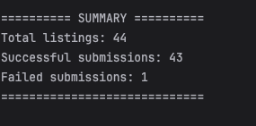
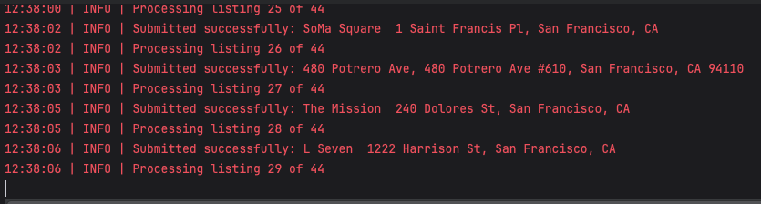
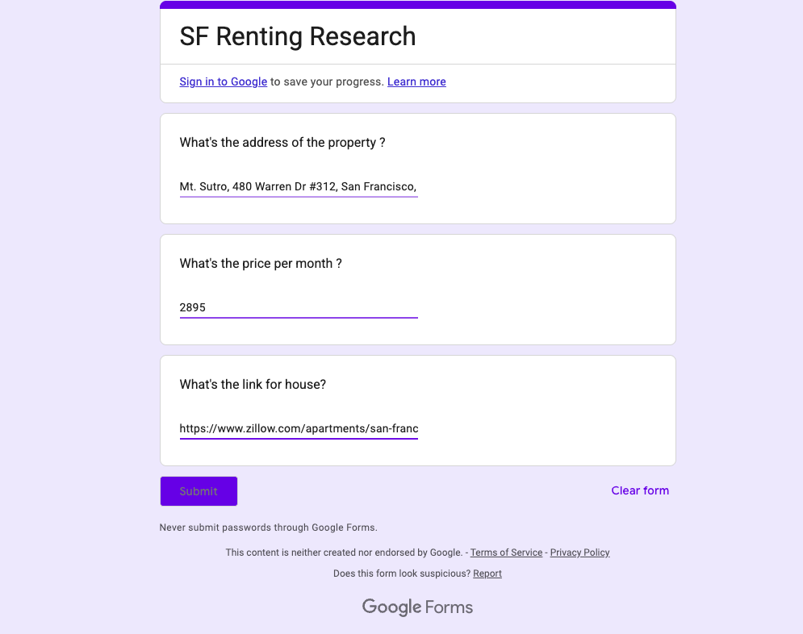

# Rental Property Data Entry Automation

## Overview

This project is a Python automation application that collects rental property information from a website and automatically enters the extracted data into a Google Form.

The goal is to reduce repetitive manual data entry, improve efficiency, and demonstrate practical web scraping and browser automation skills using Python.

## Features

- **Web Scraping:** Extracts rental property information from a webpage using Beautiful Soup.
- **HTTP Requests:** Retrieves webpage content using the Requests library.
- **Data Cleaning:** Cleans property addresses and rental prices before processing.
- **Browser Automation:** Uses Selenium to populate and submit Google Forms.
- **Input Validation:** Skips incomplete property records.
- **Duplicate Prevention:** Avoids processing the same listing URL more than once during a single run.
- **Error Handling:** Handles HTTP request failures, browser errors, and submission timeouts.
- **Execution Summary:** Reports successful and failed form submissions.

## Technologies Used

- Python
- Requests
- Beautiful Soup 4
- Selenium
- Google Forms
- Chrome WebDriver

## Project Structure

```text
data_entry_automatic/
├── main.py
├── requirements.txt
└── README.md
```

## Installation

### 1. Clone the repository

```bash
git clone https://github.com/bhoomipanchal4/data_entry_automatic.git
```

### 2. Navigate to the project directory

```bash
cd data_entry_automatic
```

### 3. Install dependencies

Make sure Python 3 and Google Chrome are installed.

```bash
python3 -m pip install -r requirements.txt
```

Selenium Manager can generally manage the required browser driver automatically.

## How to Run

Run the application from your terminal:

```bash
python3 main.py
```

The application will:

1. Retrieve the rental listings webpage.
2. Extract property addresses, prices, and listing URLs.
3. Clean and validate the extracted information.
4. Open Chrome using Selenium.
5. Enter the property information into the configured Google Form.
6. Display a summary of successful and failed submissions.

**Note:** The Google Form URL and field selectors must be configured correctly in `main.py`. The application requires an internet connection.

## Error Handling and Data Validation

The application includes basic error handling for network requests, missing property information, and Selenium browser operations.

It also removes duplicate listing URLs within a single execution to help prevent repeated submissions.


## Screenshots

### 1. Console Output


### 2. Final Results Summary


### 3. Google Form Automation Using Selenium



## Author

**Bhoomi Panchal**
